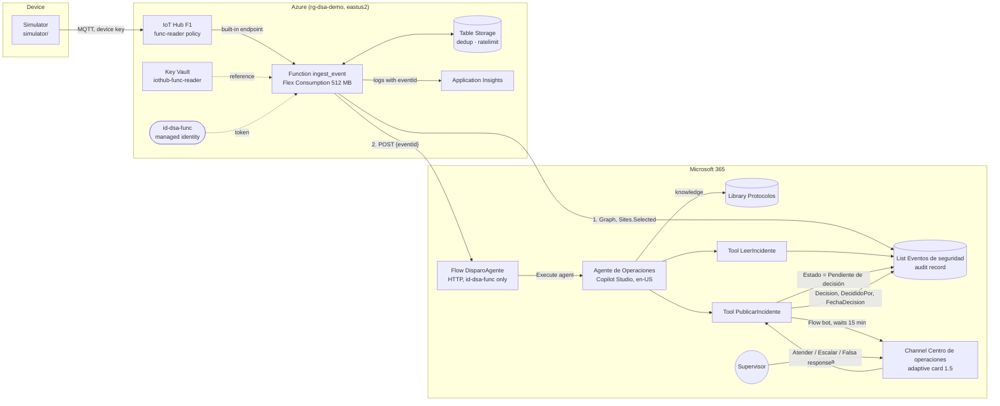

# From sensor to agent

A reference architecture that brings a physical security alert into Microsoft Teams as a proposal, and leaves the decision to a person.

[Versión en español](README.md)

A sensor reports an event: a forced door, motion in a restricted zone or repeated access denials. Azure receives the signal, discards duplicates and enriches it. Microsoft 365 turns it into an audited incident. A Copilot Studio agent reads the incident, looks up the protocol and proposes a severity. The supervisor decides on a Teams card, and the decision is recorded with who, what and when.

**The agent proposes; the person decides.** No component performs a physical action or contacts anyone. The list of what is never automated is in [docs/gobernanza.md](docs/gobernanza.md).

All data is fictitious: zones, cameras, protocols and accounts.

Want to see it working before you deploy it? Three short demo videos, one per act (in Spanish, with subtitles), are in [docs/videos.md](docs/videos.md).

Want to rebuild it understanding every step? The [technical manual](docs/Manual_Tecnico.md) (in Spanish) explains every configuration and every piece of code: what it does, why, and how to verify it.

Resource names stay in Spanish (for example, the list `Eventos de seguridad`, the library `Protocolos` and the channel `Centro de operaciones`), because the scripts and the agent use them as identifiers. The rest of the repository documentation is in Spanish.

## Contents

- [Architecture](#architecture)
- [Requirements](#requirements)
- [Step-by-step deployment](#step-by-step-deployment)
- [Costs](#costs)
- [Cleanup](#cleanup)
- [Governance](#governance)
- [Repository layout](#repository-layout)
- [License](#license)

## Architecture



How it works:

1. The simulator sends the event to IoT Hub over MQTT, with the device's own key.
2. The `ingest_event` Function validates the event against a closed schema with no free-text fields. It groups identical events within 60 seconds into a single incident and limits creation to 10 incidents per minute.
3. The Function creates the incident in the `Eventos de seguridad` list with Microsoft Graph. It can only write to the demo site ([Sites.Selected](https://learn.microsoft.com/graph/permissions-selected-overview)).
4. It then calls the `DisparoAgente` flow with a single value, the `eventId`. The HTTP trigger only accepts the Function's managed identity ([OAuth authentication for HTTP request triggers](https://learn.microsoft.com/power-automate/oauth-authentication)). The flow runs the agent ([Call Copilot Studio agents from Power Automate](https://learn.microsoft.com/power-automate/call-copilot-studio-agent#call-a-standard-harness-agent-from-a-cloud-flow)).
5. The agent reads the incident, looks up the protocol in the `Protocolos` library and calls `PublicarIncidente`.
6. `PublicarIncidente` posts the card to the channel and waits up to 15 minutes for a response ([Post adaptive card and wait for a response](https://learn.microsoft.com/connectors/teams/#post-adaptive-card-and-wait-for-a-response)). The supervisor's response is written to the list. With no response, the incident moves to `Sin respuesta`, with no decision recorded.

Latency target: from the event to the visible card, p90 of 30 seconds or less, and never more than 60. Design decisions are in [docs/adr/](docs/adr/) and the technical plan in [specs/02-plan.md](specs/02-plan.md).

## Requirements

This guide describes the **recommended configuration**. The live demo of the session uses a different one, for the reasons in [ADR-002](docs/adr/ADR-002-entorno-demo-en-vivo.md).

### Tenant and licenses

| Requirement | Detail |
| --- | --- |
| Test Microsoft 365 tenant | Dedicated to the demo, with Teams and SharePoint. A person with an admin role grants `Sites.Selected` and the consents ([docs/admin-sites-selected.md](docs/admin-sites-selected.md)) |
| Azure subscription **in the same tenant** | Owner on the resource group, region `eastus2`. The Function's managed identity only exists in its subscription's tenant |
| Power Platform environment `DSA-Demo`, **Sandbox** type | With Dataverse, a security group, its own DLP policy and Dataverse auditing. Don't use a *Trial* environment: it's deleted after 30 days and doesn't support pay-as-you-go ([Create an environment](https://learn.microsoft.com/power-platform/admin/create-environment#create-an-environment-with-a-database), [Throttling errors](https://learn.microsoft.com/troubleshoot/power-platform/copilot-studio/licensing/throttling-errors-agents#solution)) |
| Service account `agente-dsa` | No admin roles. With a license that allows publishing: a Copilot Studio user license with credits assigned to the environment, or Microsoft 365 Copilot. Trial licenses don't enable publishing ([Billing FAQ](https://learn.microsoft.com/microsoft-copilot-studio/faq-billing-licensing)) |
| Account `Supervisor Demo` | User with no admin roles, member of the Teams team |
| Copilot Studio credits | Pay-as-you-go linked to the Azure subscription, with its own budget and a per-agent limit ([Set up pay-as-you-go](https://learn.microsoft.com/power-platform/admin/pay-as-you-go-set-up#create-a-billing-plan), [ADR-001](docs/adr/ADR-001-facturacion-creditos-copilot-studio.md)) |
| Agent created in `en-US` | The primary language can't be changed after the agent is created ([Language support](https://learn.microsoft.com/microsoft-copilot-studio/authoring-language-support)). The instructions ask it to answer in Spanish |
| *Workflows* app allowed in Teams | Required to post the card as *Flow bot* ([Teams connector, known issues](https://learn.microsoft.com/connectors/teams/#known-issues-and-limitations-with-actions)) |

### Local tools

| Tool | Version | Installation |
| --- | --- | --- |
| PowerShell | 7 or later | `winget install --id Microsoft.PowerShell --source winget` ([Install PowerShell on Windows](https://learn.microsoft.com/powershell/scripting/install/installing-powershell-on-windows)) |
| Python | 3.11 or later | [python.org](https://www.python.org/downloads/) |
| Azure CLI | Latest | [Install the Azure CLI](https://learn.microsoft.com/cli/azure/install-azure-cli) |
| Bicep for Azure CLI | Latest | `az bicep install` ([Install Bicep](https://learn.microsoft.com/azure/azure-resource-manager/bicep/install)) |
| IoT extension for Azure CLI | Latest | `az extension add --name azure-iot` ([az iot hub device-identity](https://learn.microsoft.com/cli/azure/iot/hub/device-identity)) |
| Microsoft Graph module for PowerShell | 2.x | `Install-Module Microsoft.Graph -Scope CurrentUser` ([Install the Microsoft Graph PowerShell SDK](https://learn.microsoft.com/powershell/microsoftgraph/installation)) |
| Git | Any recent version | — |

The `infra/` scripts have Bash versions (`deploy.sh`, `destroy.sh`). The other scripts are PowerShell 7.

## Step-by-step deployment

Estimated time: 60 minutes, with the tenant, subscription, environment and licenses already available. Run every command in PowerShell 7 from the repository root.

### 1. Prepare the repository (5 min)

On Windows, clone into a short path, for example `C:\src`. Some Python dependencies have long paths, and installation fails in deep folders if Windows long paths aren't enabled.

```powershell
git clone <repository-url> C:\src\del-sensor-al-agente
cd C:\src\del-sensor-al-agente
python -m venv .venv
.\.venv\Scripts\Activate.ps1
python -m pip install -r requirements-dev.txt
python -m pytest -q
Copy-Item .env.example .env
```

The tests don't need Azure or the tenant: they must all pass. `.env` is never versioned: it holds names, paths and the device keys.

### 2. Prepare Microsoft 365 (10 min)

In the portal, with an admin account:

1. Create the demo SharePoint site and a second, empty site, `DSA-Control`. The second one proves that the Function **can't** write outside the demo site.
2. Create the private team `DSA-Demo` with a **standard** channel `Centro de operaciones`. The Teams connector doesn't post to private channels ([Teams connector, known issues](https://learn.microsoft.com/connectors/teams/#known-issues-and-limitations-with-actions)).
3. Add `agente-dsa` and `Supervisor Demo` as team members.

Fill in `.env`: `DSA_SITE_URL`, `DSA_TEAM_NAME`, `DSA_CHANNEL_NAME` and `DSA_ENVIRONMENT_KIND=sandbox`.

### 3. Provision SharePoint (5 min)

```powershell
./sharepoint/provision.ps1
```

It opens a delegated Microsoft Graph session. It creates the `Eventos de seguridad` list with its columns and the `Protocolos` library, converts the protocols in `protocols/` to `.docx` and uploads them. It also checks that `DSA-Control` exists and is empty.

The script is idempotent: a second run creates nothing. To check only the local part, without a tenant: `./sharepoint/provision.ps1 -LocalOnly`.

Write down the site ID and the list ID. Step 6 needs them:

```powershell
Connect-MgGraph -Scopes 'Sites.Read.All' -ContextScope Process -NoWelcome
$site = Invoke-MgGraphRequest -Method GET -Uri 'v1.0/sites/<host>:/sites/<site-path>?$select=id'
$filter = [uri]::EscapeDataString("displayName eq 'Eventos de seguridad'")
$list = (Invoke-MgGraphRequest -Method GET -Uri "v1.0/sites/$($site.id)/lists?`$filter=$filter&`$select=id").value[0]
$site.id; $list.id
```

### 4. Deploy Azure (10 min)

```powershell
az login
./infra/deploy.ps1
```

The script registers missing resource providers, creates the `rg-dsa-demo` group in `eastus2`, deploys `infra/main.bicep` and publishes the Function. To preview changes without applying them: `./infra/deploy.ps1 -WhatIf`.

At the end it prints the client ID and object ID of the `id-dsa-func` identity, and the two admin commands ready to copy. No value is written to files.

If the subscription already has a free IoT Hub, use `./infra/deploy.ps1 -IotHubSku B1` (adds USD 10 per month, see [docs/costos.md](docs/costos.md)).

### 5. Grant `Sites.Selected` (5 min)

A SharePoint administrator runs the two commands printed in step 4. The details, the permissions of whoever runs them and the check are in [docs/admin-sites-selected.md](docs/admin-sites-selected.md).

Expected result: the identity has the `write` role on the demo site only. `DSA-Control` has no permission for it.

### 6. Configure the agent in Copilot Studio (20 min)

With the `agente-dsa` account, follow [agent/GUIA-CONFIGURACION.md](agent/GUIA-CONFIGURACION.md). In short:

1. Solution `DelSensorAlAgente` in the `DSA-Demo` environment.
2. Flows `DisparoAgente`, `LeerIncidente` and `PublicarIncidente`. In `DisparoAgente`, *Who can trigger the flow* = *Specific users in my tenant*, with two object IDs: `id-dsa-func` and the operator (for `demo/retrigger.ps1` and `demo/inject.ps1`). The `PublicarIncidente` definition is generated from the cards with `python -m agent.flows.build_publicar_incidente` (step 6 of the guide).
3. Agent "Agente de Operaciones" in `en-US`, with the instructions in [agent/instrucciones.md](agent/instrucciones.md), the `Protocolos` knowledge source and both tools.
4. Agent publishing and the agent's monthly credit limit.

Copy the `DisparoAgente` HTTP trigger URL into `DSA_FLOW_URL` in `.env`. It isn't a signed URL: the trigger requires a Microsoft Entra ID token. Even so, don't version it.

Deploy again with the three values. The deployment is idempotent:

```powershell
./infra/deploy.ps1 -GraphSiteId '<siteId>' -GraphListId '<listId>' -AgentFlowUrl '<DisparoAgente URL>'
```

### 7. Register the devices (3 min)

Use the IoT Hub name printed in step 4.

```powershell
az iot hub device-identity create --hub-name <iotHub> --device-id sim-01 --auth-type login
az iot hub device-identity create --hub-name <iotHub> --device-id preflight-01 --auth-type login
az iot hub device-identity connection-string show --hub-name <iotHub> --device-id sim-01 --auth-type login --query connectionString -o tsv
az iot hub device-identity connection-string show --hub-name <iotHub> --device-id preflight-01 --auth-type login --query connectionString -o tsv
```

Paste the first string into `IOTHUB_DEVICE_CONNECTION_STRING` and the second into `IOTHUB_PREFLIGHT_CONNECTION_STRING`, in `.env`. Each device has its own key.

### 8. First card (2 min)

```powershell
./infra/set-always-ready.ps1 -Scenario ensayo -ResourceGroup <resource group>
python -m simulator --type puerta_forzada --zone Z-03
```

Expected result:

- A new item in the `Eventos de seguridad` list, moving from `Nuevo` to `Pendiente de decisión`.
- A "Propuesta del Agente de Operaciones" card in the `Centro de operaciones` channel, in 30 seconds or less. In 10 rehearsals on 2026-10-26 the p90 was 22.6 s and the maximum 36.1 s ([tests/integration/ensayos.md](tests/integration/ensayos.md)).
- When a button is pressed, the decision, who made it and the time are stored in the list.

To test deduplication: `python -m simulator --type movimiento_zona_restringida --zone Z-01 --burst 20`. Result: a single incident with `Repeticiones = 20`.

When you're done, turn off the *always ready* instance: `./infra/set-always-ready.ps1 -Scenario reposo -ResourceGroup <resource group>` (you can omit `-ResourceGroup` if `DSA_RESOURCE_GROUP` is loaded in the session).

### Running the demo

| Command | Purpose |
| --- | --- |
| `./demo/preflight.ps1` | Checks every component in 3 minutes or less, in green, yellow or red |
| `./demo/reset.ps1` | Sends test incidents to the site recycle bin and clears deduplication, in 2 minutes or less. With `-All`, every incident |
| `./demo/retrigger.ps1 -EventId <id>` | Triggers the agent again for an incident left in `Nuevo` |
| `./demo/inject.ps1 -Type <type> -Zone <zone>` | Fallback without Azure: creates the incident and triggers the agent with the operator's session |
| `./demo/measure.ps1 -Last 10` | Measures latency per segment for the latest incidents |

The full session script is in [demo/RUNBOOK.md](demo/RUNBOOK.md) (Spanish).

## Costs

### Azure

List prices for `eastus2`, checked on 2026-10-26. Details and scenarios in [docs/costos.md](docs/costos.md).

| Scenario | Monthly cost |
| --- | --- |
| Normal month: idle, 20 h of rehearsals and 8 h of session, IoT Hub `F1` | ≈ USD 0.40 |
| *Always ready* instance forgotten all month, IoT Hub `F1` | ≈ USD 7.90 |
| Normal month with IoT Hub `B1` | ≈ USD 10.40 |
| Reasonable worst case: forgotten instance with IoT Hub `B1` | ≈ USD 17.90 |

Controls included in the template: a single 512 MB instance, *always ready* off by default, a daily log ingestion cap, a limit of 10 incidents per minute and a USD 20 budget with an alert at 80 % to the resource group's *Owner* role ([Create and manage budgets](https://learn.microsoft.com/azure/cost-management-billing/costs/tutorial-acm-create-budgets)).

Microsoft 365 licenses and Copilot Credits are not included in this figure.

### Copilot Credits

Agent and agent flow runs consume Copilot Credits according to the official rate table ([Billing rates and management](https://learn.microsoft.com/microsoft-copilot-studio/requirements-messages-management#copilot-credits-billing-rates)):

| Item | Official rate | Per incident | Credits |
| --- | --- | --- | --- |
| Agent action: `LeerIncidente` tool | 5 per action | 1 | 5 |
| Generative answer with the `Protocolos` knowledge source | 2 per answer | 1 | 2 |
| Agent action: `PublicarIncidente` tool | 5 per action | 1 | 5 |
| Flow actions in `DisparoAgente`, `LeerIncidente` and `PublicarIncidente` | 13 per 100 actions | ≈ 20 actions | ≈ 2.6 |
| **Estimated total** | | | **≈ 15 per incident** |

This is an estimate: orchestration can add agent actions. For planning, use 20 credits per incident and confirm actual consumption in the capacity report of the Power Platform admin center ([Manage Copilot Credits and capacity](https://learn.microsoft.com/power-platform/admin/manage-copilot-studio-copilot-credits-capacity)). A month of development, testing, rehearsals and one session uses around 2,200 credits ([ADR-001](docs/adr/ADR-001-facturacion-creditos-copilot-studio.md)).

Deduplication in Azure protects this consumption: a burst of 20 identical events costs one incident, not twenty.

**Monthly credit limit per agent.** In the Power Platform admin center you set a credit limit per agent, with an alert and a stop when it's reached ([Manage monthly consumption limits](https://learn.microsoft.com/power-platform/admin/manage-copilot-studio-copilot-credits-capacity#manage-monthly-consumption-limits-for-copilot-studio-agents)). There is no default limit: you set it agent by agent. It has two caveats: it doesn't stop the agent's flows, which are controlled by the capacity assigned to the environment, and it doesn't act instantly ([Manage capacity](https://learn.microsoft.com/power-platform/admin/manage-copilot-studio-copilot-credits-capacity#manage-capacity)). That's why it's set with a margin: 3,000 credits for this demo's agent.

An Azure Cost Management budget alerts, but doesn't stop consumption. That's why the credit budget lives in its own resource group, separate from the infrastructure, with alerts at 50 %, 80 % and 100 % ([ADR-001](docs/adr/ADR-001-facturacion-creditos-copilot-studio.md)).

## Cleanup

```powershell
./infra/set-always-ready.ps1 -Scenario reposo
./infra/destroy.ps1
```

`destroy` lists the resources, asks for confirmation, deletes the whole resource group and purges the soft-deleted Key Vault. In Bash: `infra/destroy.sh`.

Deleting the group removes the `id-dsa-func` identity and its permissions. If you deploy again, repeat the admin commands and update the object ID in the `DisparoAgente` trigger.

In Microsoft 365, delete or turn off manually:

1. The link between the environment and the pay-as-you-go plan. Billing stops from that moment.
2. The `DelSensorAlAgente` solution, with the agent and the flows.
3. The `Eventos de seguridad` list and the `Protocolos` library, if you no longer need them.

## Governance

The guide for taking this pattern to production is in [docs/gobernanza.md](docs/gobernanza.md) (Spanish):

- What is automated and what a person always decides.
- Service account and maker credentials.
- Dedicated environment and data policies (DLP).
- Data in the payload and its retention.
- Monitoring with the *Activity* and *Monitor* pages.
- Quotas and credits.
- The IoT Hub connection string as conscious debt, with its production alternative.
- A 10-point checklist to go from demo to production.

## Repository layout

| Folder | Contents |
| --- | --- |
| `infra/` | Bicep, deployment, deletion and *always ready* scenario switch |
| `simulator/` | Python device simulator, with burst mode |
| `function/` | Azure Function: validate, deduplicate, enrich, write to SharePoint and trigger the agent |
| `schemas/` | JSON schemas for the event and the zone catalog |
| `data/` | Fictitious zone catalog |
| `sharepoint/` | List and library provisioning |
| `protocols/` | Fictitious protocols per event type |
| `agent/` | Agent instructions, test cases and configuration guide |
| `cards/` | Adaptive Cards 1.5 |
| `demo/` | Runbook, preflight, reset, fallback and measurement |
| `docs/` | Governance, costs and architecture decisions (ADR) |
| `specs/` | Constitution, specification, plan and tasks |

Tests and lint: `python -m pytest -q`, `ruff check .` and `az bicep lint --file infra/main.bicep`.

## License

[MIT](LICENSE). An educational, community project with no commercial purpose.
