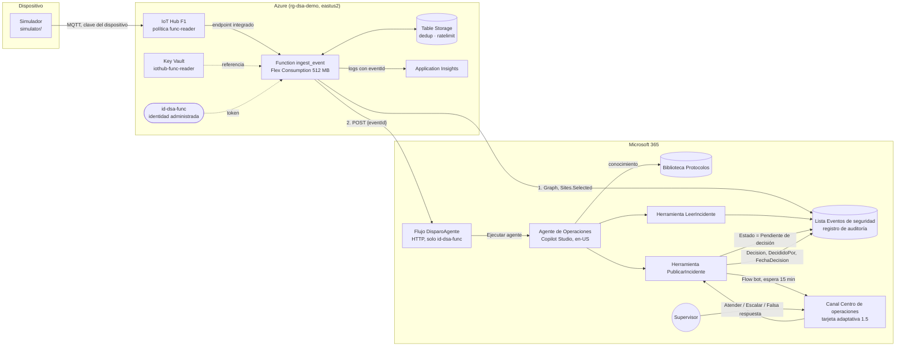

# Del sensor al agente

Arquitectura de referencia para llevar una alerta de seguridad física a Microsoft Teams como una propuesta, y dejar la decisión a una persona.

[English version](README.en.md)

Un sensor reporta un evento: una puerta forzada, movimiento en una zona restringida o accesos denegados repetidos. Azure recibe la señal, descarta duplicados y la enriquece. Microsoft 365 la convierte en un incidente auditado. Un agente de Copilot Studio lee el incidente, consulta el protocolo y propone una severidad. El supervisor decide en una tarjeta de Teams, y la decisión queda registrada con quién, qué y cuándo.

**El agente propone; la persona decide.** Ningún componente ejecuta una acción física ni contacta a nadie. La lista de lo que nunca se automatiza está en [docs/gobernanza.md](docs/gobernanza.md).

Todos los datos son ficticios: zonas, cámaras, protocolos y cuentas.

¿Quieres verlo funcionando antes de desplegarlo? Hay tres videos cortos de la demo, uno por acto, en [docs/videos.md](docs/videos.md).

¿Quieres reproducirlo entendiendo cada paso? El [manual técnico](docs/Manual_Tecnico.md) explica cada configuración y cada pieza de código: qué hace, por qué y cómo comprobarla.

## Contenido

- [Arquitectura](#arquitectura)
- [Requisitos](#requisitos)
- [Despliegue paso a paso](#despliegue-paso-a-paso)
- [Costos](#costos)
- [Limpieza](#limpieza)
- [Gobernanza](#gobernanza)
- [Estructura del repositorio](#estructura-del-repositorio)
- [Licencia](#licencia)

## Arquitectura



Cómo funciona:

1. El simulador envía el evento a IoT Hub por MQTT, con la clave propia del dispositivo.
2. La Function `ingest_event` valida el evento contra un esquema cerrado, sin campos de texto libre. Agrupa en un solo incidente los eventos iguales de 60 segundos y limita la creación a 10 incidentes por minuto.
3. La Function crea el incidente en la lista `Eventos de seguridad` con Microsoft Graph. Solo tiene permiso de escritura sobre el sitio de la demo ([Sites.Selected](https://learn.microsoft.com/graph/permissions-selected-overview)).
4. Después llama al flujo `DisparoAgente` con un solo dato, el `eventId`. El disparador HTTP solo admite a la identidad administrada de la Function ([OAuth authentication for HTTP request triggers](https://learn.microsoft.com/power-automate/oauth-authentication)). El flujo ejecuta el agente ([Call Copilot Studio agents from Power Automate](https://learn.microsoft.com/power-automate/call-copilot-studio-agent#call-a-standard-harness-agent-from-a-cloud-flow)).
5. El agente lee el incidente, consulta el protocolo en la biblioteca `Protocolos` y llama a `PublicarIncidente`.
6. `PublicarIncidente` publica la tarjeta en el canal y espera la respuesta hasta 15 minutos ([Post adaptive card and wait for a response](https://learn.microsoft.com/connectors/teams/#post-adaptive-card-and-wait-for-a-response)). La respuesta del supervisor se escribe en la lista. Sin respuesta, el incidente queda en `Sin respuesta`, sin ninguna decisión.

Meta de latencia: del evento a la tarjeta visible, p90 de 30 segundos o menos, y nunca más de 60. Las decisiones de diseño están en [docs/adr/](docs/adr/) y el plan técnico en [specs/02-plan.md](specs/02-plan.md).

## Requisitos

Esta guía describe la **configuración recomendada**. La demo en vivo de la sesión usa otra, por las razones de [ADR-002](docs/adr/ADR-002-entorno-demo-en-vivo.md).

### Tenant y licencias

| Requisito | Detalle |
| --- | --- |
| Tenant de Microsoft 365 de pruebas | Dedicado a la demo, con Teams y SharePoint. Una persona con rol de administrador concede `Sites.Selected` y los consentimientos ([docs/admin-sites-selected.md](docs/admin-sites-selected.md)) |
| Suscripción de Azure **en el mismo tenant** | Owner sobre el grupo de recursos, región `eastus2`. La identidad administrada de la Function solo existe en el tenant de su suscripción |
| Entorno de Power Platform `DSA-Demo` de tipo **Sandbox** | Con Dataverse, grupo de seguridad, política DLP propia y auditoría de Dataverse. No uses un entorno *Trial*: se elimina a los 30 días y no admite pago por uso ([Create an environment](https://learn.microsoft.com/power-platform/admin/create-environment#create-an-environment-with-a-database), [Throttling errors](https://learn.microsoft.com/troubleshoot/power-platform/copilot-studio/licensing/throttling-errors-agents#solution)) |
| Cuenta de servicio `agente-dsa` | Sin roles de administrador. Con una licencia que permita publicar: licencia de usuario de Copilot Studio con créditos asignados al entorno, o Microsoft 365 Copilot. Las licencias de prueba no habilitan la publicación ([FAQ de facturación](https://learn.microsoft.com/microsoft-copilot-studio/faq-billing-licensing)) |
| Cuenta `Supervisor Demo` | Usuario sin roles de administrador, miembro del equipo de Teams |
| Créditos de Copilot Studio | Pago por uso vinculado a la suscripción de Azure, con presupuesto propio y límite por agente ([Set up pay-as-you-go](https://learn.microsoft.com/power-platform/admin/pay-as-you-go-set-up#create-a-billing-plan), [ADR-001](docs/adr/ADR-001-facturacion-creditos-copilot-studio.md)) |
| Agente creado en `en-US` | El idioma principal no se cambia después de crear el agente ([Language support](https://learn.microsoft.com/microsoft-copilot-studio/authoring-language-support)). Las instrucciones le piden responder en español |
| App *Workflows* permitida en Teams | La necesita la publicación de la tarjeta como *Flow bot* ([Teams connector, known issues](https://learn.microsoft.com/connectors/teams/#known-issues-and-limitations-with-actions)) |

### Herramientas locales

| Herramienta | Versión | Instalación |
| --- | --- | --- |
| PowerShell | 7 o superior | `winget install --id Microsoft.PowerShell --source winget` ([Install PowerShell on Windows](https://learn.microsoft.com/powershell/scripting/install/installing-powershell-on-windows)) |
| Python | 3.11 o superior | [python.org](https://www.python.org/downloads/) |
| Azure CLI | La más reciente | [Install the Azure CLI](https://learn.microsoft.com/cli/azure/install-azure-cli) |
| Bicep para Azure CLI | La más reciente | `az bicep install` ([Install Bicep](https://learn.microsoft.com/azure/azure-resource-manager/bicep/install)) |
| Extensión de IoT para Azure CLI | La más reciente | `az extension add --name azure-iot` ([az iot hub device-identity](https://learn.microsoft.com/cli/azure/iot/hub/device-identity)) |
| Módulo Microsoft Graph para PowerShell | 2.x | `Install-Module Microsoft.Graph -Scope CurrentUser` ([Install the Microsoft Graph PowerShell SDK](https://learn.microsoft.com/powershell/microsoftgraph/installation)) |
| Git | Cualquiera reciente | — |

Los scripts de `infra/` tienen versión en Bash (`deploy.sh`, `destroy.sh`). El resto de los scripts son de PowerShell 7.

## Despliegue paso a paso

Tiempo estimado: 60 minutos, con el tenant, la suscripción, el entorno y las licencias ya disponibles. Todos los comandos se ejecutan en PowerShell 7 desde la raíz del repositorio.

### 1. Preparar el repositorio (5 min)

En Windows, clona en una ruta corta, por ejemplo `C:\src`. Algunas dependencias de Python tienen rutas largas y la instalación falla en carpetas muy profundas si las rutas largas de Windows no están activadas.

```powershell
git clone <url-del-repositorio> C:\src\del-sensor-al-agente
cd C:\src\del-sensor-al-agente
python -m venv .venv
.\.venv\Scripts\Activate.ps1
python -m pip install -r requirements-dev.txt
python -m pytest -q
Copy-Item .env.example .env
```

Las pruebas no necesitan Azure ni el tenant: deben pasar todas. `.env` nunca se versiona: guarda nombres, rutas y las claves de los dispositivos.

### 2. Preparar Microsoft 365 (10 min)

En el portal, con una cuenta de administrador:

1. Crea el sitio de SharePoint de la demo y un segundo sitio vacío, `DSA-Control`. El segundo sirve para comprobar que la Function **no** puede escribir fuera del sitio de la demo.
2. Crea el equipo privado `DSA-Demo` con un canal **estándar** `Centro de operaciones`. El conector de Teams no publica en canales privados ([Teams connector, known issues](https://learn.microsoft.com/connectors/teams/#known-issues-and-limitations-with-actions)).
3. Agrega `agente-dsa` y `Supervisor Demo` como miembros del equipo.

Completa en `.env`: `DSA_SITE_URL`, `DSA_TEAM_NAME`, `DSA_CHANNEL_NAME` y `DSA_ENVIRONMENT_KIND=sandbox`.

### 3. Aprovisionar SharePoint (5 min)

```powershell
./sharepoint/provision.ps1
```

Abre una sesión delegada de Microsoft Graph. Crea la lista `Eventos de seguridad` con sus columnas y la biblioteca `Protocolos`, convierte los protocolos de `protocols/` a `.docx` y los sube. Comprueba también que `DSA-Control` existe y está vacío.

El script es idempotente: una segunda ejecución no crea nada. Para revisar solo la parte local, sin tenant: `./sharepoint/provision.ps1 -LocalOnly`.

Anota el ID del sitio y el de la lista. Los necesita el paso 6:

```powershell
Connect-MgGraph -Scopes 'Sites.Read.All' -ContextScope Process -NoWelcome
$site = Invoke-MgGraphRequest -Method GET -Uri 'v1.0/sites/<host>:/sites/<ruta-del-sitio>?$select=id'
$filter = [uri]::EscapeDataString("displayName eq 'Eventos de seguridad'")
$list = (Invoke-MgGraphRequest -Method GET -Uri "v1.0/sites/$($site.id)/lists?`$filter=$filter&`$select=id").value[0]
$site.id; $list.id
```

### 4. Desplegar Azure (10 min)

```powershell
az login
./infra/deploy.ps1
```

El script registra los proveedores de recursos que faltan, crea el grupo `rg-dsa-demo` en `eastus2`, despliega `infra/main.bicep` y publica la Function. Para ver los cambios sin aplicarlos: `./infra/deploy.ps1 -WhatIf`.

Al final imprime el client ID y el object ID de la identidad `id-dsa-func`, y los dos comandos del administrador listos para copiar. Ningún valor se escribe en archivos.

Si la suscripción ya tiene un IoT Hub gratuito, usa `./infra/deploy.ps1 -IotHubSku B1` (suma USD 10 al mes, ver [docs/costos.md](docs/costos.md)).

### 5. Conceder `Sites.Selected` (5 min)

Un administrador de SharePoint ejecuta los dos comandos que imprimió el paso 4. El detalle, los permisos de quien los ejecuta y la comprobación están en [docs/admin-sites-selected.md](docs/admin-sites-selected.md).

Resultado esperado: la identidad tiene el rol `write` solo sobre el sitio de la demo. `DSA-Control` no tiene ningún permiso para ella.

### 6. Configurar el agente en Copilot Studio (20 min)

Con la cuenta `agente-dsa`, sigue [agent/GUIA-CONFIGURACION.md](agent/GUIA-CONFIGURACION.md). En resumen:

1. Solución `DelSensorAlAgente` en el entorno `DSA-Demo`.
2. Flujos `DisparoAgente`, `LeerIncidente` y `PublicarIncidente`. En `DisparoAgente`, *Who can trigger the flow* = *Specific users in my tenant*, con dos object IDs: el de `id-dsa-func` y el del operador (para `demo/retrigger.ps1` y `demo/inject.ps1`). La definición de `PublicarIncidente` se genera desde las tarjetas con `python -m agent.flows.build_publicar_incidente` (paso 6 de la guía).
3. Agente "Agente de Operaciones" en `en-US`, con las instrucciones de [agent/instrucciones.md](agent/instrucciones.md), el conocimiento `Protocolos` y las dos herramientas.
4. Publicación del agente y límite mensual de créditos del agente.

Copia la URL del disparador HTTP de `DisparoAgente` en `DSA_FLOW_URL` de `.env`. No es una URL con firma: el disparador exige un token de Microsoft Entra ID. Aun así, no la versiones.

Vuelve a desplegar con los tres valores. El despliegue es idempotente:

```powershell
./infra/deploy.ps1 -GraphSiteId '<siteId>' -GraphListId '<listId>' -AgentFlowUrl '<URL de DisparoAgente>'
```

### 7. Registrar los dispositivos (3 min)

Usa el nombre del IoT Hub que imprimió el paso 4.

```powershell
az iot hub device-identity create --hub-name <iotHub> --device-id sim-01 --auth-type login
az iot hub device-identity create --hub-name <iotHub> --device-id preflight-01 --auth-type login
az iot hub device-identity connection-string show --hub-name <iotHub> --device-id sim-01 --auth-type login --query connectionString -o tsv
az iot hub device-identity connection-string show --hub-name <iotHub> --device-id preflight-01 --auth-type login --query connectionString -o tsv
```

Pega la primera cadena en `IOTHUB_DEVICE_CONNECTION_STRING` y la segunda en `IOTHUB_PREFLIGHT_CONNECTION_STRING`, en `.env`. Cada dispositivo tiene su propia clave.

### 8. Primera tarjeta (2 min)

```powershell
./infra/set-always-ready.ps1 -Scenario ensayo -ResourceGroup <grupo de recursos>
python -m simulator --type puerta_forzada --zone Z-03
```

Resultado esperado:

- Un elemento nuevo en la lista `Eventos de seguridad`, que pasa de `Nuevo` a `Pendiente de decisión`.
- Una tarjeta "Propuesta del Agente de Operaciones" en el canal `Centro de operaciones`, en 30 segundos o menos. En 10 ensayos del 2026-10-26 el p90 fue de 22,6 s y el máximo, de 36,1 s ([tests/integration/ensayos.md](tests/integration/ensayos.md)).
- Al pulsar un botón, la decisión, quién la tomó y la hora quedan en la lista.

Para probar la deduplicación: `python -m simulator --type movimiento_zona_restringida --zone Z-01 --burst 20`. Resultado: un solo incidente con `Repeticiones = 20`.

Al terminar, apaga la instancia *always ready*: `./infra/set-always-ready.ps1 -Scenario reposo -ResourceGroup <grupo de recursos>`. Si `DSA_RESOURCE_GROUP` está cargada en la sesión, `-ResourceGroup` se puede omitir.

### Operación de la demo

| Comando | Para qué |
| --- | --- |
| `./demo/preflight.ps1` | Comprueba todos los componentes en 3 minutos o menos, en verde, amarillo o rojo |
| `./demo/reset.ps1` | Manda los incidentes de prueba a la papelera del sitio y vacía la deduplicación, en 2 minutos o menos. Con `-All`, todos los incidentes |
| `./demo/retrigger.ps1 -EventId <id>` | Vuelve a disparar al agente para un incidente que quedó en `Nuevo` |
| `./demo/inject.ps1 -Type <tipo> -Zone <zona>` | Contingencia sin Azure: crea el incidente y dispara al agente con la sesión del operador |
| `./demo/measure.ps1 -Last 10` | Mide la latencia por tramos de los últimos incidentes |

El guion completo de la sesión está en [demo/RUNBOOK.md](demo/RUNBOOK.md).

## Costos

### Azure

Precios de lista de `eastus2`, consultados el 2026-10-26. Detalle y escenarios en [docs/costos.md](docs/costos.md).

| Escenario | Costo mensual |
| --- | --- |
| Mes normal: reposo, 20 h de ensayos y 8 h de sesión, IoT Hub `F1` | ≈ USD 0,40 |
| Instancia *always ready* olvidada todo el mes, IoT Hub `F1` | ≈ USD 7,90 |
| Mes normal con IoT Hub `B1` | ≈ USD 10,40 |
| Peor caso razonable: olvido con IoT Hub `B1` | ≈ USD 17,90 |

Controles incluidos en la plantilla: una sola instancia de 512 MB, *always ready* apagado por defecto, tope diario de ingesta de registros, límite de 10 incidentes por minuto y un presupuesto de USD 20 con aviso al 80 % al rol *Owner* del grupo de recursos ([Create and manage budgets](https://learn.microsoft.com/azure/cost-management-billing/costs/tutorial-acm-create-budgets)).

Las licencias de Microsoft 365 y los Copilot Credits no entran en esta cifra.

### Copilot Credits

Las ejecuciones del agente y de sus flujos consumen Copilot Credits según la tabla oficial de tarifas ([Billing rates and management](https://learn.microsoft.com/microsoft-copilot-studio/requirements-messages-management#copilot-credits-billing-rates)):

| Concepto | Tarifa oficial | Por incidente | Créditos |
| --- | --- | --- | --- |
| Acción del agente: herramienta `LeerIncidente` | 5 por acción | 1 | 5 |
| Respuesta generativa con el conocimiento `Protocolos` | 2 por respuesta | 1 | 2 |
| Acción del agente: herramienta `PublicarIncidente` | 5 por acción | 1 | 5 |
| Acciones de flujo de `DisparoAgente`, `LeerIncidente` y `PublicarIncidente` | 13 por cada 100 acciones | ≈ 20 acciones | ≈ 2,6 |
| **Total estimado** | | | **≈ 15 por incidente** |

Es una estimación: la orquestación puede sumar acciones del agente. Para planificar, usa 20 créditos por incidente y confirma el consumo real en el informe de capacidad del Power Platform admin center ([Manage Copilot Credits and capacity](https://learn.microsoft.com/power-platform/admin/manage-copilot-studio-copilot-credits-capacity)). Un mes de desarrollo, pruebas, ensayos y una sesión consume del orden de 2 200 créditos ([ADR-001](docs/adr/ADR-001-facturacion-creditos-copilot-studio.md)).

La deduplicación en Azure protege este consumo: una ráfaga de 20 eventos iguales cuesta un incidente, no veinte.

**Límite mensual de créditos por agente.** En el Power Platform admin center se fija un límite de créditos por agente, con aviso y parada al alcanzarlo ([Manage monthly consumption limits](https://learn.microsoft.com/power-platform/admin/manage-copilot-studio-copilot-credits-capacity#manage-monthly-consumption-limits-for-copilot-studio-agents)). No hay un límite por defecto: se configura agente por agente. Tiene dos matices: no detiene los flujos del agente, que se controlan con la capacidad asignada al entorno, y no actúa al instante ([Manage capacity](https://learn.microsoft.com/power-platform/admin/manage-copilot-studio-copilot-credits-capacity#manage-capacity)). Por eso se fija con margen: 3 000 créditos para el agente de esta demo.

Un presupuesto de Azure Cost Management avisa, pero no detiene el consumo. Por eso el presupuesto de créditos va en un grupo de recursos propio, separado del de la infraestructura, con avisos al 50 %, 80 % y 100 % ([ADR-001](docs/adr/ADR-001-facturacion-creditos-copilot-studio.md)).

## Limpieza

```powershell
./infra/set-always-ready.ps1 -Scenario reposo
./infra/destroy.ps1
```

`destroy` muestra los recursos, pide confirmación, borra el grupo de recursos completo y purga el Key Vault en borrado temporal. En Bash: `infra/destroy.sh`.

Al borrar el grupo desaparece la identidad `id-dsa-func` con sus permisos. Si vuelves a desplegar, repite los comandos del administrador y actualiza el object ID en el disparador de `DisparoAgente`.

En Microsoft 365, borra o desactiva a mano:

1. El vínculo del entorno con el plan de pago por uso. Desde ese momento no se factura.
2. La solución `DelSensorAlAgente`, con el agente y los flujos.
3. La lista `Eventos de seguridad` y la biblioteca `Protocolos`, si ya no las necesitas.

## Gobernanza

La guía para llevar este patrón a producción está en [docs/gobernanza.md](docs/gobernanza.md):

- Qué se automatiza y qué decide siempre una persona.
- Cuenta de servicio y credenciales del creador.
- Entorno dedicado y políticas de datos (DLP).
- Datos en el payload y su retención.
- Monitoreo con las páginas *Activity* y *Monitor*.
- Cuotas y créditos.
- La cadena de conexión de IoT Hub como deuda consciente, con su alternativa de producción.
- Una lista de verificación de 10 puntos para pasar de demo a producción.

## Estructura del repositorio

| Carpeta | Contenido |
| --- | --- |
| `infra/` | Bicep, despliegue, eliminación y cambio de escenario *always ready* |
| `simulator/` | Simulador de dispositivos en Python, con modo ráfaga |
| `function/` | Azure Function: validar, deduplicar, enriquecer, escribir en SharePoint y disparar al agente |
| `schemas/` | Esquemas JSON del evento y del catálogo de zonas |
| `data/` | Catálogo ficticio de zonas |
| `sharepoint/` | Aprovisionamiento de la lista y la biblioteca |
| `protocols/` | Protocolos ficticios por tipo de evento |
| `agent/` | Instrucciones del agente, casos de prueba y guía de configuración |
| `cards/` | Tarjetas adaptativas 1.5 |
| `demo/` | Runbook, preflight, reinicio, contingencia y medición |
| `docs/` | Gobernanza, costos y decisiones de arquitectura (ADR) |
| `specs/` | Constitución, especificación, plan y tareas |

Pruebas y lint: `python -m pytest -q`, `ruff check .` y `az bicep lint --file infra/main.bicep`.

## Licencia

[MIT](LICENSE). Proyecto educativo y comunitario, sin fines comerciales.
