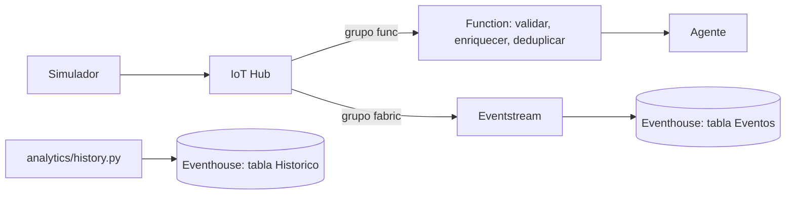

# Ruta analítica: los datos antes del agente

Material de la charla "Un agente vale lo que valen sus datos" (IA DAY 2026). Muestra con KQL lo que hace el pipeline antes de que la IA lea nada: cuántos eventos crudos llegan, cuántos incidentes quedan después de deduplicar, qué zona se sale de lo normal y cómo decide la persona.

Especificación: [`specs/05-ampliacion-ia-day.md`](../specs/05-ampliacion-ia-day.md), historia HU-15.



La ruta analítica lee de su **propio grupo de consumidores** (`fabric`). No compite con la Function ni cambia su código.

## Qué hay en esta carpeta

| Archivo | Para qué sirve |
| --- | --- |
| `history.py` | Genera el histórico ficticio: 30 días de incidentes con la misma lógica del pipeline y una anomalía a propósito en el Archivo documental (Z-05). Determinista y sin datos personales |
| `fabric-setup.ps1` | Crea el área de trabajo, el Eventhouse, el Eventstream y las tablas `Eventos` e `Historico`, y carga el histórico. Idempotente |
| `kql/01-rafaga-crudos-vs-incidentes.kql` | La ráfaga vista como dato: 20 eventos, 1 incidente, 19 repeticiones |
| `kql/02-reduccion-antes-del-agente.kql` | Cuánto trabajo le ahorra la deduplicación al agente |
| `kql/03-anomalias-por-zona.kql` | Detección de anomalías por zona con `series_decompose_anomalies` |
| `kql/04-la-decision-como-dato.kql` | La decisión humana medida: escaladas, falsas alarmas, sin respuesta, minutos hasta decidir |

## Requisitos

- La solución de Azure desplegada **con la ruta analítica activada** (paso 1).
- Una capacidad de Fabric. La **prueba gratuita de 60 días** alcanza para Eventstream, Eventhouse y KQL ([Try Microsoft Fabric for free](https://learn.microsoft.com/fabric/fundamentals/fabric-trial)). Se activa desde el administrador de cuentas de Fabric (tu foto, arriba a la derecha) → *Iniciar período de prueba*.
- Python con el entorno del repositorio y la sesión de `az` con tu cuenta.

## Paso a paso

### 1. Activar la ruta en Azure

```powershell
./infra/deploy.ps1 -EnableAnalyticsRoute
```

Agrega al IoT Hub el grupo de consumidores `fabric` y la política `fabric-reader`, que solo tiene `ServiceConnect`.

> **Importante:** mientras uses la ruta, despliega **siempre** con `-EnableAnalyticsRoute`. La lista de políticas del hub es completa: un despliegue sin la opción borra `fabric-reader` y el Eventstream deja de recibir eventos sin avisar.

✅ Siga cuando: `az iot hub policy list --hub-name <iotHub> --query "[].keyName" -o tsv` muestre `func-reader` y `fabric-reader`.

### 2. Montar Fabric y cargar el histórico

```powershell
python -m analytics.history
./analytics/fabric-setup.ps1
```

✅ Siga cuando: el script termine con `[cargado] 196 incidentes ficticios en Historico`.

### 3. Conectar el Eventstream al IoT Hub (a mano, fuera de cámara)

La fuente IoT Hub de Eventstream se autentica con la clave de una política de acceso compartido ([Add Azure IoT Hub source to an eventstream](https://learn.microsoft.com/fabric/real-time-intelligence/event-streams/add-source-azure-iot-hub)). Este paso lo haces tú, porque maneja una clave.

1. Copia la clave **directamente al portapapeles**, sin mostrarla en pantalla:
   ```powershell
   az iot hub policy show --hub-name <iotHub> -n fabric-reader --query primaryKey -o tsv | Set-Clipboard
   ```
2. En Fabric, abre el área de trabajo **DSA IA Day** → `es-dsa-eventos` → **Agregar origen** → **Azure IoT Hub**.
3. Crea la conexión: nombre del hub, política `fabric-reader`, pega la clave. Grupo de consumidores: **`fabric`**. Formato de datos: **JSON**.
4. Agrega el destino **Eventhouse** → `eh-dsa` → base `eh-dsa` → tabla existente **`Eventos`**, con la asignación de columnas por nombre.
5. **Publica** el Eventstream y vacía el portapapeles (copia cualquier otro texto).

✅ Siga cuando: envíes un evento con el simulador y `Eventos | take 10` lo muestre en menos de un minuto.

### 4. Probar las consultas de la charla

```powershell
python -m simulator --type movimiento_zona_restringida --zone Z-01 --burst 20
```

Abre la base `eh-dsa` en Fabric y ejecuta los archivos de `kql/` en orden.

✅ Siga cuando: la consulta 01 muestre `eventosCrudos = 20`, `incidentes = 1`, `repeticiones = 19`, y la 03 muestre la zona Z-05.

## Manejo de la clave `fabric-reader`

Revisión de seguridad de T-058 (DEC-IA-02):

- **Qué permite.** `ServiceConnect` **no es de solo lectura**: además de leer los eventos, permitiría enviar mensajes a los dispositivos e invocar métodos directos ([permisos de IoT Hub](https://learn.microsoft.com/azure/iot-hub/authenticate-authorize-sas#iot-hub-permissions)). No permite tocar el registro de dispositivos ni conectarse como uno. La mitigación es que los dispositivos de esta demo no atienden mensajes, métodos ni gemelos, y una prueba (`infra/tests/DsaInfra.Tests.ps1`) falla si alguien los agrega.
- **Dónde vive.** Solo en la conexión de Fabric. **Nunca** en archivos, `.env`, notas, chats, capturas ni en el repositorio.
- **En la charla.** La conexión se crea antes y fuera de cámara. La clave no se proyecta nunca.
- **Rotación.** Ante cualquier sospecha de exposición:
  ```powershell
  az iot hub policy renew-key --hub-name <iotHub> -n fabric-reader --renew-key secondary
  ```
  Cambia la conexión de Fabric a la clave secundaria y después renueva la primaria con `--renew-key primary`.

## Cierre después del evento

1. Borra la política, o vuelve a desplegar sin `-EnableAnalyticsRoute`:
   ```powershell
   az iot hub policy delete --hub-name <iotHub> -n fabric-reader
   ```
2. En Fabric, borra la conexión del IoT Hub y el área de trabajo **DSA IA Day**.
3. Termina la prueba de Fabric si no la vas a usar: **Catálogo de OneLake → Gobernar → Capacidades → Pruebas** ([End a Fabric trial capacity](https://learn.microsoft.com/fabric/fundamentals/fabric-trial#end-a-fabric-trial-capacity)). Si no, vence sola a los 60 días.
4. Elimina Azure con `./infra/destroy.ps1`.

## Costo

| Pieza | Costo |
| --- | --- |
| Fabric (Eventstream, Eventhouse, KQL) | USD 0 con la prueba de 60 días |
| Azure (IoT Hub F1, Function, monitoreo) | Centavos, dentro del presupuesto de USD 20 al mes |
