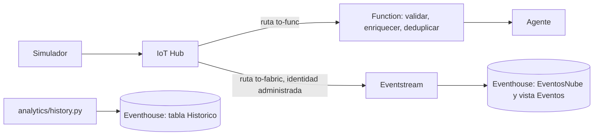

# Ruta analítica: los datos antes del agente

Material de la charla "Un agente vale lo que valen sus datos" (IA DAY 2026). Muestra con KQL lo que hace el pipeline antes de que la IA lea nada: cuántos eventos crudos llegan, cuántos incidentes quedan después de deduplicar, qué zona se sale de lo normal y cómo decide la persona.

Especificación: [`specs/05-ampliacion-ia-day.md`](../specs/05-ampliacion-ia-day.md), historia HU-15.



El IoT Hub reenvía cada mensaje por **dos rutas**: `to-func`, hacia el endpoint integrado que lee la Function, y `to-fabric`, hacia el Eventstream. La ruta hacia Fabric se autentica con la **identidad administrada del hub**: ese endpoint solo admite Microsoft Entra ID, así que **no hay ninguna clave** que copiar, guardar ni rotar ([IoT Hub endpoints](https://learn.microsoft.com/azure/iot-hub/iot-hub-devguide-endpoints#custom-endpoints-for-message-routing)). La función de enrutar hacia Fabric está en versión preliminar.

## Qué hay en esta carpeta

| Archivo | Para qué sirve |
| --- | --- |
| `history.py` | Genera el histórico ficticio: 30 días de incidentes con la misma lógica del pipeline y una anomalía a propósito en el Archivo documental (Z-05). Determinista y sin datos personales |
| `fabric-setup.ps1` | Crea el área de trabajo, el Eventhouse, el Eventstream con su topología, la tabla `EventosNube`, la vista `Eventos` y la tabla `Historico`; carga el histórico y da a la identidad del IoT Hub el rol Colaborador. Idempotente |
| `kql/01-rafaga-crudos-vs-incidentes.kql` | La ráfaga vista como dato: 20 eventos, 1 incidente, 19 repeticiones |
| `kql/02-reduccion-antes-del-agente.kql` | Cuánto trabajo le ahorra la deduplicación al agente |
| `kql/03-anomalias-por-zona.kql` | Detección de anomalías por zona con `series_decompose_anomalies` |
| `kql/04-la-decision-como-dato.kql` | La decisión humana medida: escaladas, falsas alarmas, sin respuesta, minutos hasta decidir |

## Requisitos

- La solución de Azure desplegada (`infra/deploy.ps1`).
- Una capacidad de Fabric. La **prueba gratuita de 60 días** alcanza para Eventstream, Eventhouse y KQL ([Try Microsoft Fabric for free](https://learn.microsoft.com/fabric/fundamentals/fabric-trial)). Se activa desde el administrador de cuentas de Fabric (tu foto, arriba a la derecha) → *Iniciar período de prueba*.
- Python con el entorno del repositorio y la sesión de `az` con tu cuenta.

## Paso a paso

El orden importa: al crear el endpoint, IoT Hub prueba la conexión con Fabric, y su identidad tiene que tener permiso antes. Si no, el despliegue falla con `IH400117 ... StatusCode: 401`.

### 1. Montar Fabric y cargar el histórico

```powershell
python -m analytics.history
./analytics/fabric-setup.ps1
```

✅ Siga cuando: el script termine con las líneas `DSA_FABRIC_*`. Cópialas a `.env`: son identificadores, no secretos, pero apuntan a tu tenant, así que nunca van al repositorio.

### 2. Crear la identidad del IoT Hub

Despliega con la ruta activada pero **sin** los datos de Fabric todavía en la sesión:

```powershell
Remove-Item env:DSA_FABRIC_ENDPOINT_URI -ErrorAction SilentlyContinue
./infra/deploy.ps1 -EnableAnalyticsRoute
```

✅ Siga cuando: el resumen muestre `Identidad del hub: <objectId>`.

### 3. Dar permiso a la identidad del hub en Fabric

```powershell
./analytics/fabric-setup.ps1 -IotHubPrincipalId <objectId del paso 2>
```

✅ Siga cuando: aparezca `identidad del IoT Hub como Colaborador del área de trabajo`.

### 4. Crear el endpoint y las rutas

Carga `.env` en la sesión y despliega otra vez:

```powershell
./infra/deploy.ps1 -EnableAnalyticsRoute
```

> **Importante:** mientras uses la ruta, despliega **siempre** con `-EnableAnalyticsRoute` y con las variables `DSA_FABRIC_*` cargadas. Sin ellas, el despliegue quita las rutas y la Function vuelve a recibir por la ruta de respaldo.

✅ Siga cuando: `az rest --method get --url "https://management.azure.com/<id del hub>?api-version=2026-05-01-preview" --query "properties.routing.routes[].name"` muestre `to-func` y `to-fabric`. `az iot hub show` no muestra los endpoints de Fabric porque usa una versión anterior de la API.

### 5. Probar las consultas de la charla

```powershell
python -m simulator --type movimiento_zona_restringida --zone Z-01 --burst 20
```

Los eventos llegan a `EventosNube` en unos 10 a 60 segundos. Abre la base `eh-dsa` en Fabric y ejecuta los archivos de `kql/` en orden.

✅ Siga cuando: la consulta 01 muestre `eventosCrudos = 20`, `incidentes = 1`, `repeticiones = 19`, y la 03 muestre la zona Z-05.

## Por qué no hay ninguna clave

La primera versión de esta ruta (T-058) leía del IoT Hub con una política de acceso compartido. La revisión de seguridad señaló que `ServiceConnect` no es de solo lectura: también permite enviar mensajes a los dispositivos e invocar métodos ([permisos de IoT Hub](https://learn.microsoft.com/azure/iot-hub/authenticate-authorize-sas#iot-hub-permissions)). La versión final (DEC-IA-02 v2) elimina esa política: el hub empuja los mensajes a Fabric con su identidad, que solo tiene el rol Colaborador en el área de trabajo de la demo. No hay nada que se pueda filtrar en la sala ni que haya que rotar.

## Cierre después del evento

1. Vuelve a desplegar sin `-EnableAnalyticsRoute`: quita las rutas, el endpoint y la identidad del hub.
2. En Fabric, borra el área de trabajo **DSA IA Day**. Con ella se va el rol de la identidad del hub.
3. Termina la prueba de Fabric si no la vas a usar: **Catálogo de OneLake → Gobernar → Capacidades → Pruebas** ([End a Fabric trial capacity](https://learn.microsoft.com/fabric/fundamentals/fabric-trial#end-a-fabric-trial-capacity)). Si no, vence sola a los 60 días.
4. Elimina Azure con `./infra/destroy.ps1`.

## Costo

| Pieza | Costo |
| --- | --- |
| Fabric (Eventstream, Eventhouse, KQL) | USD 0 con la prueba de 60 días |
| Azure (IoT Hub F1, Function, monitoreo) | Centavos, dentro del presupuesto de USD 20 al mes |
