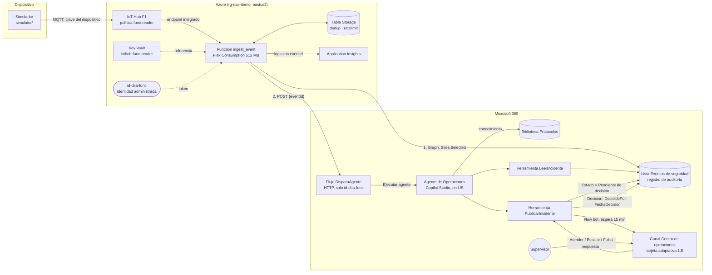

# Plan técnico — "Del sensor al agente"

| Campo | Valor |
| --- | --- |
| Versión | 1.0 |
| Fecha | 2026-10-26 |
| Estado | **Aprobado** ("aprobado fase 2" de Daniel, 2026-10-26) |
| Especificación base | `specs/01-especificacion.md` v1.9 (aprobada el 2026-10-09) |
| Tareas | `specs/03-tareas.md` |
| Autores | arquitecto-cloud (Azure), arquitecto-m365 (Microsoft 365), integración: líder-especificacion |

Este plan describe la **configuración recomendada** (especificación §8.1). Las diferencias de la demo en vivo están solo en [ADR-002](../docs/adr/ADR-002-entorno-demo-en-vivo.md) y en la §11 de este documento.

---

## 1. Resumen

Un dispositivo (simulado, o una Raspberry Pi en el futuro) envía un evento a **IoT Hub**. Una **Azure Function** lo valida, descarta duplicados, lo enriquece con el catálogo de zonas y crea un incidente en la lista de SharePoint `Eventos de seguridad`, que es el registro de auditoría. Después llama a un **flujo del agente con disparador HTTP** que ejecuta el **agente de Copilot Studio**. El agente lee el incidente, consulta el protocolo en la biblioteca `Protocolos`, propone una severidad y llama a la herramienta `PublicarIncidente`. Esa herramienta responde al agente de inmediato y después publica una **tarjeta adaptativa** en el canal `Centro de operaciones` de Teams. La tarjeta espera la decisión del supervisor hasta 15 minutos, y la decisión queda escrita en la lista con quién, qué y cuándo.

Nada en la cadena ejecuta una acción física ni contacta a nadie (Art. 1).

## 2. Arquitectura final



### Tramos y presupuesto de latencia (RNF-01)

| Tramo | Desde → hasta | Meta p90 | Cómo se mide | Evidencia actual |
| --- | --- | --- | --- | --- |
| 1 | `enqueuedTimeUtc` en IoT Hub → respuesta de Graph al crear el elemento | ≤ 10 s | Application Insights, consulta KQL versionada (§7) | Pendiente (necesita Azure) |
| 2 | Elemento creado → tarjeta visible en el canal | ≤ 20 s | `createdDateTime` del elemento contra `createdDateTime` del mensaje del canal, unidos por `eventId` (§7) | Spike: p90 10,5 s con una herramienta ([ADR-003](../docs/adr/ADR-003-disparo-del-agente.md)) |
| Total | `enqueuedTimeUtc` → tarjeta visible | ≤ 30 s, nunca > 60 s | Suma por `eventId` | Pendiente |

## 3. Decisiones

| DEC | Tema | ADR | Estado |
| --- | --- | --- | --- |
| DEC-01 | Publicación de la tarjeta y captura de la decisión | [ADR-008](../docs/adr/ADR-008-publicacion-tarjeta-y-decision.md) | Aceptado |
| DEC-02 | Puente de Azure a Microsoft 365 | [ADR-004](../docs/adr/ADR-004-puente-azure-m365.md) | Aceptado |
| DEC-03 | Hosting de la Function | [ADR-005](../docs/adr/ADR-005-hosting-function.md) | Aceptado |
| DEC-04 | Ventana de deduplicación y límite por minuto | [ADR-006](../docs/adr/ADR-006-deduplicacion.md) | Aceptado |
| DEC-05 | Mecanismo que dispara al agente | [ADR-003](../docs/adr/ADR-003-disparo-del-agente.md) | Aceptado |
| DEC-06 | Facturación de Copilot Credits | [ADR-001](../docs/adr/ADR-001-facturacion-creditos-copilot-studio.md) | Recomendado |
| DEC-07 | Dónde corre la demo en vivo | [ADR-002](../docs/adr/ADR-002-entorno-demo-en-vivo.md) | Aceptado |
| — | Identidades y permisos mínimos | [ADR-007](../docs/adr/ADR-007-identidad-y-permisos.md) | Aceptado (revisión del revisor-seguridad en T-045) |

Los ADR propuestos pasaron a "Aceptado" con el "aprobado fase 2" del 2026-10-26.

## 4. Contratos de datos

### 4.1 Evento del dispositivo — `schemas/evento-dispositivo.schema.json`

JSON Schema draft 2020-12, `additionalProperties: false` (CA-01.3).

| Campo | Tipo | Regla |
| --- | --- | --- |
| `eventId` | string | UUID (`format: uuid` y patrón) |
| `deviceId` | string | `^DEV-[A-Z0-9-]+$` |
| `type` | string | `movimiento_zona_restringida` \| `puerta_forzada` \| `acceso_denegado_repetido` |
| `zone` | string | `^Z-\d{2}$` |
| `timestamp` | string | ISO 8601 en UTC con `Z` (`format: date-time` y patrón que exige `Z`) |
| `rawSeverity` | string | `Baja` \| `Media` \| `Alta` \| `Crítica` |
| `schemaVersion` | string | Constante `"1.0"` |

Ejemplo:

```json
{
  "schemaVersion": "1.0",
  "eventId": "3f2b8a4e-6c1d-4e9a-9f7b-2d5c8e1a0b37",
  "deviceId": "DEV-SIM-01",
  "type": "puerta_forzada",
  "zone": "Z-03",
  "timestamp": "2026-11-04T19:32:05Z",
  "rawSeverity": "Alta"
}
```

El esquema no tiene ningún campo de texto libre: no cabe un nombre, un correo ni una imagen (Art. 4). Las pruebas incluyen casos negativos (campo extra, nombre en `deviceId`, zona fuera de patrón).

### 4.2 Catálogo de zonas — `data/zonas.json`

Arreglo de zonas ficticias (Art. 5), validado por `schemas/zona.schema.json`:

```json
{ "zone": "Z-03", "zoneName": "Bodega norte", "cameraId": "CAM-03", "site": "Sede Demo Centro", "baseSeverity": "Media" }
```

`SeveridadInicial` = el mayor entre `rawSeverity` y `baseSeverity` (§5.0). Una zona que no está en el catálogo se trata como evento inválido (ADR-004, paso 4).

### 4.3 Lista `Eventos de seguridad` — `sharepoint/columnas.json`

`sharepoint/columnas.json` es la **única fuente** del contrato: lo usa el script de aprovisionamiento (CA-07.1), lo usa la Function para armar el cuerpo de Graph y lo usa la prueba de contrato (CA-06.3).

| Nombre interno | Tipo | Obligatoria | Escribe | Valores |
| --- | --- | --- | --- | --- |
| `Title` | Texto | Sí | Function | `{TipoEvento} · {Zona}` |
| `EventId` | Texto, **único e indexado** | Sí | Function | `eventId` del primer evento de la ventana |
| `DeviceId` | Texto | Sí | Function | |
| `TipoEvento` | Elección | Sí | Function | los tres tipos de §4.1 |
| `Zona` | Texto | Sí | Function | `Z-xx` |
| `NombreZona` | Texto | Sí | Function | del catálogo |
| `CamaraId` | Texto | Sí | Function | del catálogo |
| `Sitio` | Texto | Sí | Function | del catálogo |
| `SeveridadRaw` | Elección | Sí | Function | escala §5.0 |
| `SeveridadInicial` | Elección | Sí | Function | escala §5.0 |
| `Repeticiones` | Número entero | Sí | Function | ≥ 1 |
| `FechaEventoUtc` | Fecha y hora | Sí | Function | `timestamp` del dispositivo |
| `RecibidoUtc` | Fecha y hora | Sí | Function | `enqueuedTimeUtc` de IoT Hub |
| `EsPrueba` | Sí/No | Sí | Function | `Sí` solo si el dispositivo es `preflight-01` (ADR-007) |
| `Estado` | Elección | Sí | Function, flujos | `Nuevo`, `Pendiente de decisión`, `Atendido`, `Escalado`, `Falsa alarma`, `Sin respuesta` |
| `SeveridadPropuesta` | Elección | No | `PublicarIncidente` | escala §5.0, a lo sumo un nivel de diferencia |
| `JustificacionSeveridad` | Texto multilínea | No | `PublicarIncidente` | obligatoria si difiere (CA-08.7) |
| `ResumenAgente` | Texto multilínea | No | `PublicarIncidente` | ≤ 3 líneas en la tarjeta |
| `ProtocoloAplicado` | Texto | No | `PublicarIncidente` | nombre del documento |
| `PublicacionSolicitadaUtc` | Fecha y hora | No | `PublicarIncidente` | `utcNow()` antes de publicar |
| `Decision` | Elección | No | `PublicarIncidente` | `Atender`, `Escalar a autoridades`, `Falsa alarma` |
| `DecididoPor` | Persona | No | `PublicarIncidente` | quien respondió la tarjeta |
| `FechaDecision` | Fecha y hora | No | `PublicarIncidente` | |
| `Observacion` | Texto multilínea | No | `PublicarIncidente` | campo opcional de la tarjeta |

Transiciones de `Estado` (CA-10.1): `Nuevo` → `Pendiente de decisión` → `Atendido` \| `Escalado` \| `Falsa alarma` \| `Sin respuesta`. Cada escritura comprueba primero el estado actual (ADR-008).

### 4.4 Biblioteca `Protocolos`

Un documento por tipo de evento (CA-07.3). La fuente es Markdown en `protocols/`. Se sube como **`.docx`**, porque es el formato que la opción de conocimiento SharePoint de Copilot Studio indexa con seguridad: la lista de tipos admitidos para SharePoint es doc, docx, ppt, pptx, pdf, xls y xlsx, sin Markdown ([Quotas and limits — Upload SharePoint limits](https://learn.microsoft.com/microsoft-copilot-studio/requirements-quotas#limits), [Knowledge sources summary](https://learn.microsoft.com/microsoft-copilot-studio/knowledge-copilot-studio#knowledge-source-agent-settings)). La conversión la hace `sharepoint/build-protocols.py` con una plantilla fija.

Columnas adicionales: `TipoEvento` (elección, la misma de la lista) y `VersionProtocolo` (texto; `Version` está reservado en las bibliotecas), más `HashFuente` (texto, hash SHA-256 de la fuente para que la carga sea idempotente).

### 4.5 Mensaje de la Function al flujo `DisparoAgente`

```json
{ "eventId": "3f2b8a4e-6c1d-4e9a-9f7b-2d5c8e1a0b37" }
```

Solo el `eventId`. El agente lee los datos del incidente de la lista; el registro de auditoría es la única fuente (ADR-003).

### 4.6 Herramientas del agente

| Herramienta | Tipo | Entrada | Salida |
| --- | --- | --- | --- |
| `LeerIncidente` | Flujo del agente | `eventId` | Los campos de la Function de §4.3, más `HoraLocal` en `America/Bogota` con sufijo `COT` (RNF-08) |
| `PublicarIncidente` | Flujo del agente (ADR-008) | `eventId`, `severidadPropuesta`, `justificacionSeveridad`, `resumen`, `pasosProtocolo`, `protocoloAplicado` | `publicado` \| `ya publicado` |

### 4.7 Tarjetas — `cards/`

Adaptive Cards **1.5**, la versión que admite Teams ([Use Adaptive Cards in Copilot Studio](https://learn.microsoft.com/microsoft-copilot-studio/adaptive-cards-overview), [Adaptive Cards for agent design — host compatibility](https://learn.microsoft.com/agents/design-guidelines/adaptive-cards-for-agent-design#schema-and-host-compatibility)). Sin plantillas, porque Power Automate no las admite ([Send proactive Teams messages](https://learn.microsoft.com/microsoft-copilot-studio/advanced-proactive-message#send-a-proactive-adaptive-card)): el flujo arma el JSON con expresiones.

| Archivo | Uso |
| --- | --- |
| `cards/incidente-normal.json` | Severidad propuesta Baja o Media |
| `cards/incidente-alta.json` | Severidad propuesta Alta o Crítica (contenedor con estilo `attention` y la palabra de la severidad en texto, RNF-07) |
| `cards/incidente-solo-lectura.json` | Reemplazo tras la decisión (CA-10.2) |
| `cards/sin-respuesta.json` | Aviso al vencer los 15 min (CA-10.5) |
| `cards/ejemplos/*.data.json` | Datos de ejemplo para las pruebas |

Contenido (CA-09.2): encabezado "Propuesta del Agente de Operaciones", tipo de evento, zona y nombre, hora local "HH:mm COT", `SeveridadInicial` → `SeveridadPropuesta` con justificación, repeticiones, resumen (`maxLines: 3`), pasos del protocolo (`maxLines: 3`), `Ref. {eventId}` en letra pequeña (sirve para medir el tramo 2), un `Input.Text` opcional `observacion` y tres `Action.Submit` (CA-09.3) con `data.decision` = `Atender` \| `Escalar a autoridades` \| `Falsa alarma`. Sin `isEnabled` (CA-09.4). Los textos de las acciones son decisiones del supervisor, no acciones del agente (CA-09.5).

## 5. Componentes

### 5.1 Simulador — `simulator/` (HU-01, HU-02)

- `python -m simulator --type <tipo> --zone Z-03 [--burst N] [--device DEV-SIM-01]`; también el script `simulate`.
- Lee `IOTHUB_DEVICE_CONNECTION_STRING` del entorno o de `.env` (CA-01.4). `.env.example` muestra el nombre, nunca el valor.
- Valida el mensaje contra el esquema **antes** de enviarlo; un tipo desconocido termina con código 2 y un mensaje claro (CA-01.2).
- Envía con `azure-iot-device` (MQTT). `--burst` envía N mensajes con el mismo `deviceId` y `type` en menos de 10 s (CA-02.1).
- El transporte está detrás de una interfaz, así que las pruebas usan un cliente falso y no necesitan Azure.

### 5.2 Function — `function/` (HU-05, HU-06, HU-12)

- `function/function_app.py`: modelo v2, una función `ingest_event` con disparador de IoT Hub (`func.EventHubEvent`, para tener `enqueued_time`). Solo orquesta.
- `function/core/`: lógica pura y probada (CA-05.4) — `validation.py`, `enrich.py`, `severity.py`, `dedup.py`, `ratelimit.py`, `listitem.py` (arma el cuerpo con `sharepoint/columnas.json`), `graph_client.py` (reintentos con `Retry-After` y tope de 6 s), `flow_trigger.py` (token y reintentos), `telemetry.py` (registros estructurados con `eventId`).
- Orden de pasos, reintentos e idempotencia: ADR-004. Ventana y límite: ADR-006.

### 5.3 SharePoint — `sharepoint/` (HU-07)

- `sharepoint/provision.ps1` (PowerShell 7, módulo Microsoft.Graph, sesión delegada de Daniel): crea o completa la lista, sus columnas, el índice y la unicidad de `EventId`, la biblioteca `Protocolos` y comprueba que existe `DSA-Control` vacío. Es idempotente: compara contra `columnas.json` y solo agrega lo que falta (CA-07.2).
- `sharepoint/build-protocols.py` convierte `protocols/*.md` a `.docx`; `provision.ps1` los sube y los reemplaza solo si cambió su hash.

### 5.4 Agente y flujos — `agent/` (HU-08, HU-09, HU-10)

- **Solución** `DelSensorAlAgente` en el entorno de la demo, con el agente, los tres flujos y dos variables de entorno: `dsa_TimeoutDecision` (`PT15M`) y `dsa_EventosListUrl`.
- **Agente "Agente de Operaciones"**: standard harness, orquestación generativa, idioma principal `en-US`, instrucciones que ordenan responder en español (ADR-003, §8.1). Propietario: `agente-dsa`.
- **Instrucciones** (`agent/instrucciones.md`, CA-08.1): rol, tono, qué puede hacer (leer, clasificar, resumir, proponer), qué nunca hace (Art. 1), el modelo de severidad de §5.0 y el **bloque aislado** de la regla de horario (CA-08.2):

  ```text
  <!-- REGLA-HORARIO: inicio -->
  Si la hora local del incidente (America/Bogota) está fuera de 06:00–18:00, sube un nivel la severidad propuesta. Esta subida cuenta dentro del límite de un nivel.
  <!-- REGLA-HORARIO: fin -->
  ```

  Cambiar la regla en vivo exige **volver a publicar** el agente; el runbook lo incluye y mide cuánto tarda.
- **Conocimiento**: la biblioteca `Protocolos` con la opción SharePoint. Learn indica que un agente autónomo usa las credenciales del creador en disparadores y acciones ([Event trigger overview — data protection](https://learn.microsoft.com/microsoft-copilot-studio/authoring-triggers-about#data-protection-for-agents-with-triggers)); falta confirmar en el tenant que la búsqueda en el conocimiento funciona igual cuando el agente se ejecuta con *Ejecutar agente* (riesgo R-17).
- **Flujos** (dueño `agente-dsa`, conexiones de `agente-dsa`):
  - `DisparoAgente`: disparador HTTP *Usuarios específicos de mi inquilino* con dos object IDs, el de `id-dsa-func` y el de la cuenta del operador (para `demo/retrigger` y la contingencia `demo/inject`) → *Ejecutar agente* con el mensaje "Nuevo incidente {eventId}" y la configuración regional `es-CO`.
  - `LeerIncidente`: *When an agent calls the flow* → leer el elemento por `EventId` → *Respond to the agent*.
  - `PublicarIncidente`: según [ADR-008](../docs/adr/ADR-008-publicacion-tarjeta-y-decision.md).

### 5.5 Kit de demo — `demo/` (HU-14)

| Script | Qué hace | Identidad |
| --- | --- | --- |
| `demo/preflight.ps1` | Todas las comprobaciones de CA-14.3, en verde, amarillo o rojo, en ≤ 3 min | Daniel (az, Graph delegado) |
| `demo/reset.ps1` | Manda a la papelera los incidentes de prueba y vacía `dedup` y `ratelimit` en ≤ 2 min (CA-14.2) | Daniel |
| `demo/retrigger.ps1 -EventId` | Vuelve a llamar al flujo para un incidente que quedó en `Nuevo` (ADR-004) | Daniel (segunda entrada autorizada del flujo) |
| `demo/inject.ps1` | Contingencia sin Azure: crea el incidente con la sesión de Daniel y llama al flujo; también sirve para medir el tramo 2 antes de tener la Function | Daniel |
| `demo/measure.ps1` | Calcula tramo 1, tramo 2 y total de los últimos N incidentes con los percentiles de `spikes/p1-latencia/SpikeLogic.psm1` | Daniel |

## 6. Identidad y permisos

El detalle de Azure está en [ADR-007](../docs/adr/ADR-007-identidad-y-permisos.md). Resumen de todas las identidades:

| Identidad | Permisos | Cómo se otorgan |
| --- | --- | --- |
| `id-dsa-func` (identidad administrada asignada por el usuario) | Storage (blob y tablas), Key Vault Secrets User, Monitoring Metrics Publisher, Graph `Sites.Selected` con `write` solo en el sitio de la demo, entrada autorizada del disparador de `DisparoAgente` | Bicep, más dos comandos del administrador (CA-06.4), más la configuración del flujo |
| Dispositivos `sim-01`, `preflight-01` | Envío dispositivo-nube con clave simétrica propia | IoT Hub; la clave vive solo en `.env` local |
| `agente-dsa` (cuenta de servicio) | Licencia de Copilot Studio; dueña del agente, los flujos y sus conexiones (SharePoint, Teams, Office 365 Users, Copilot Studio); miembro del equipo `DSA-Demo` | Portal (guía) |
| Daniel (operador) | Owner del grupo de recursos; Storage Table Data Contributor para `demo/reset`; IoT Hub Registry Contributor solo sobre el hub, para dar de alta los dispositivos; Graph delegado `Sites.Manage.All` y `Files.ReadWrite.All` para `provision.ps1`, `Sites.ReadWrite.All` para `reset.ps1` e `inject.ps1`, `Sites.Read.All` para `retrigger.ps1` y `Sites.Read.All` con `ChannelMessage.Read.All` para `measure.ps1` (detalle en ADR-007 §3); segunda entrada autorizada en `DisparoAgente`, solo para `retrigger` e `inject` | Sesión interactiva con `-ContextScope Process`; ningún secreto en archivos |

Reglas: ningún secreto en el repositorio ni en la configuración de la app; la única cadena de conexión (la de IoT Hub para el disparador) vive en Key Vault con una política dedicada que solo tiene `ServiceConnect` (deuda documentada en ADR-005 y en `docs/gobernanza.md`). Toda tarea que toque esta tabla la revisa el revisor-seguridad.

## 7. Observabilidad y medición

- **Registros**: cada paso de la Function escribe un registro estructurado con `eventId`, `incidentEventId`, `deviceId`, `type`, `step`, `outcome` y tiempos UTC (RNF-04). Eventos con nombre: `EventRejected`, `IncidentCreated`, `RepetitionCounted`, `IncidentDiscarded`, `AgentTriggered`, `AgentTriggerAuthFailed`, `GraphRejected`, `EventFailed`.
- **Tramo 1**: `infra/queries/tramo1.kql` calcula `graphCreatedUtc − enqueuedTimeUtc` por `eventId` y su p50, p90 y máximo (CA-05.5).
- **Tramo 2 y total**: `demo/measure.ps1` lee los elementos de la lista (`createdDateTime`, `RecibidoUtc`, `EventId`) y los mensajes del canal (`createdDateTime`, texto `Ref. {eventId}`) con Graph delegado, y calcula los percentiles con `SpikeLogic.psm1`, ya probado con Pester. Así no hace falta que el flujo escriba la hora de publicación: la acción de publicar no termina hasta que alguien responde (ADR-008).
- **Agente**: página *Activity* de Copilot Studio ([Review activity](https://learn.microsoft.com/microsoft-copilot-studio/authoring-review-activity)) y el historial de ejecuciones de los flujos.
- **Costos**: alerta de presupuesto de Azure al 80 % de USD 20, enviada al rol *Owner* del grupo de recursos (sin correos en el repositorio); límite diario de ingesta en Log Analytics ([Daily cap](https://learn.microsoft.com/azure/azure-monitor/logs/daily-cap)).

## 8. Estrategia de pruebas

| Nivel | Qué cubre | Herramienta | Dónde corre |
| --- | --- | --- | --- |
| Unitarias | `function/core/*`, simulador (con transporte falso), severidad, ventana, límite, reintentos (con reloj y transporte falsos) | `pytest --cov=function/core --cov-fail-under=80` | Local y CI |
| Contrato | Esquema del evento y casos negativos; catálogo de zonas; `columnas.json` contra el cuerpo que arma la Function; tarjetas contra la copia versionada del esquema 1.5, sin `isEnabled`, solo `Action.Submit`, tamaño < 28 KB | `pytest`, `jsonschema` | Local y CI |
| Plantilla | `bicep build` + `bicep lint`; prueba sobre el JSON compilado: ninguna salida con secretos, política `func-reader` solo con `ServiceConnect`, referencia de Key Vault, `allowSharedKeyAccess: false` | `az bicep`, `pytest` | CI |
| Scripts | Lógica de percentiles y cortes (ya existe, 17 pruebas), funciones puras de `preflight` y `measure` | Pester 5+ en PowerShell 7 | Local y CI |
| Seguridad | `gitleaks` en cada push y del historial completo antes de publicar (RNF-05, CA-13.5); revisión del revisor-seguridad | `gitleaks` | CI |
| Integración en Azure | R-13 (token de la identidad para el flujo), R-14 (choque de `EventId` único), R-16 (`Sites.Selected` con identidad administrada) y CA-06.2 (403 en `DSA-Control`), R-15 (30 eventos con 512 MB), tramo 1 | Scripts de `demo/` y KQL | Suscripción de la demo |
| Integración en Microsoft 365 | R-M1 a R-M5 (espera, vencimiento, actualización de la tarjeta, doble respuesta), R-17 (conocimiento), R-18 (latencia con dos herramientas), tramo 2 | Canal `Pruebas spike`, `demo/measure.ps1` | Tenant |
| Calidad del agente | 5 casos × 3 corridas (CA-08.5, CA-08.7) | `agent/casos-prueba.md` y registro de resultados | Tenant |
| Punta a punta | 10 ensayos seguidos (OBJ-1, OBJ-2) y runbook completo dos veces | `demo/` | Tenant y Azure |

CI (RNF-06): GitHub Actions con ruff, pytest, Pester, `bicep build`/`lint`, validación de tarjetas y gitleaks. Lo que necesita el tenant queda como verificación manual con pasos exactos en `specs/04-verificacion.md` (Fase 4).

## 9. Costos

### 9.1 Azure (CA-04.5, Art. 9)

| Recurso | SKU | Costo mensual estimado | Fuente |
| --- | --- | --- | --- |
| IoT Hub | F1 (gratis, 8 000 mensajes/día) | USD 0 | [Precios de IoT Hub](https://azure.microsoft.com/pricing/details/iot-hub/) |
| Function, Flex Consumption | 512 MB, *always ready* = 1 solo en ensayos y sesión | ≈ USD 0,20 (peor caso, olvidada todo el mes: USD 5,26) | ADR-005 |
| Storage (host, tablas) | Standard LRS | < USD 0,10 | ADR-006 |
| Key Vault | Standard | < USD 0,05 (operaciones) | [Precios de Key Vault](https://azure.microsoft.com/pricing/details/key-vault/) |
| Application Insights / Log Analytics | Pago por GB con límite diario | < USD 0,10 con el volumen de la demo | [Precios de Azure Monitor](https://azure.microsoft.com/pricing/details/monitor/) |
| **Total** | | **≈ USD 0,40** en uso normal; < USD 6 en el peor caso | `docs/costos.md` (T-022) |

Si la suscripción ya tiene un IoT Hub F1, el parámetro `iotHubSku` pasa a `B1`; `docs/costos.md` recalcula el total con la página de precios vigente antes de desplegar.

### 9.2 Copilot Credits (CA-12.3, CA-12.4)

La estimación por incidente y por escenario (spike, ensayos, sesión) está en [ADR-001](../docs/adr/ADR-001-facturacion-creditos-copilot-studio.md). La recomendación es pago por uso con presupuesto propio y límite por agente. En la demo en vivo los créditos salen de la capacidad de prueba del tenant (ADR-002), y el límite por agente se mantiene: 3 000 créditos para el agente de la demo.

## 10. Riesgos

| ID | Riesgo | Prueba que lo cierra | Plan B |
| --- | --- | --- | --- |
| R-12 | Las pruebas de licencias vencen el 7 de noviembre; la hora de la sesión no está confirmada | `demo/preflight` cuenta los días | Pasar a pago la capacidad si la sesión se mueve al 6 o 7 de noviembre |
| R-13 | El flujo rechaza el token de la identidad administrada | T-025 | Registro de aplicación con credencial federada que confía en `id-dsa-func` (ADR-007) |
| R-14 | Graph no informa con claridad el choque con `EventId` único | T-026 | Consultar por `EventId` antes de crear |
| R-15 | 512 MB no alcanzan | T-027 | 2 048 MB y vigilancia del presupuesto |
| R-16 | `Sites.Selected` con el client ID de una identidad administrada no concede el acceso | T-024 | Registro de aplicación con credencial federada, igual que R-13 |
| R-17 | El conocimiento de SharePoint no responde cuando el agente corre con *Ejecutar agente* | T-036 | Herramienta `LeerProtocolo` (flujo que lee el documento por `TipoEvento`) |
| R-18 | Con dos herramientas y conocimiento, el tramo 2 pasa de 20 s | T-039 | Una sola herramienta que lea el incidente y el protocolo; instrucciones más cortas |
| R-M1 a R-M5 | Comportamientos de la tarjeta no documentados (espera, vencimiento, actualización, doble respuesta) | T-038 | Detallado en ADR-008 |
| R-19 | **Calendario**: la implementación empieza 9 días antes de la sesión | Seguimiento diario de §12 | Recorte por prioridad: primero las historias Must; HU-02 y HU-12 se mantienen porque son pequeñas; HU-03 queda fuera |
| R-20 | ~~Suscripción de Azure inexistente~~ **Cerrado el 2026-10-26:** existe en el tenant de la demo, pago por uso sin límite de gasto, Daniel es Owner. Los proveedores de recursos aún no están registrados (se registran en T-023) | — | — |

## 11. Configuración recomendada frente a la demo en vivo

La guía, el README y este plan describen la configuración recomendada (§8.1 de la especificación). Para la sesión rigen las desviaciones de [ADR-002](../docs/adr/ADR-002-entorno-demo-en-vivo.md): tenant de la empresa, entorno predeterminado sin grupo de seguridad ni DLP propia, capacidad de prueba de Copilot Studio y `agente-dsa` con prueba de Copilot Studio. El preflight muestra amarillo por el entorno predeterminado y remite al ADR.

La suscripción de Azure **debe estar en el mismo tenant** que SharePoint y Teams: la identidad administrada de la Function solo existe en el tenant de su suscripción, y `Sites.Selected` se concede a una entidad de servicio de ese mismo tenant. Usar una suscripción de otro tenant obligaría a un registro de aplicación multiinquilino con credenciales, que el Art. 4 descarta.

## 12. Calendario replanificado (propuesta)

La especificación fijaba el congelamiento de código el 28 de octubre; la implementación empieza el 27. Propuesta:

| Fecha | Hito |
| --- | --- |
| 2026-10-26 | Compuerta 2 |
| 2026-10-27 a 29 | Implementación en paralelo: E1, núcleo de E2 sin Azure, E3 en el tenant, Bicep. **Límite para tener la suscripción: 29 de octubre** |
| 2026-10-30 | Despliegue en Azure, pruebas R-13 a R-16, integración de punta a punta |
| 2026-10-31 | 10 ensayos (OBJ-1, OBJ-2), casos del agente, ajustes |
| 2026-11-01 | Congelamiento de código e infraestructura |
| 2026-11-02 | Congelamiento de contenido; grabación de los 3 videos de respaldo; README en inglés |
| 2026-11-03 | Ensayo general (runbook completo dos veces), Fase 4 de verificación |
| 2026-11-04 | Sesión; el repositorio se hace público tras gitleaks y la revisión de seguridad |

**HU-03 (sensor físico) queda fuera**: su condición era tener E1 a E4 en verde el 25 de octubre, y no se cumplió.

**Contingencia si no hay suscripción el 29 de octubre:** la parte de Microsoft 365 se termina igual. Para la sesión se usan los videos de respaldo del tramo de Azure y, en vivo, `demo/inject.ps1`, que crea el incidente con la sesión de Daniel y llama al flujo. Esto cambia el alcance de la demo en vivo y necesita la aprobación de Daniel en ese momento.

## 13. Decisiones tomadas en este plan

Las preguntas que dejaron abiertas los arquitectos se resuelven así, con la opción más segura y simple:

| Pregunta | Decisión |
| --- | --- |
| Nombre del esquema | `schemas/evento-dispositivo.schema.json`, como dice CA-01.1; no se cambia la especificación |
| Cómo medir que la tarjeta es visible | Con la hora de creación del mensaje del canal leída por Graph con el permiso delegado `ChannelMessage.Read.All` de Daniel, solo para `demo/measure.ps1`. Daniel lo consiente al ejecutar el script por primera vez (T-040) |
| CA-10.6 (segunda respuesta) | Se propone reformularlo (§14): la plataforma descarta la segunda respuesta antes de llegar al flujo |
| Avisos de presupuesto | Al rol *Owner* del grupo de recursos; ningún correo en el repositorio |
| Primer uso de la suscripción | Desplegar la infraestructura mínima y correr la prueba de R-13 antes de terminar la Function (T-025) |
| Lo que queda del spike | El agente y el flujo nuevos se crean limpios dentro de la solución; se reutilizan el canal `Pruebas spike` y `SpikeLogic.psm1`. El agente `Spike Latencia EN`, su flujo HTTP y la lista `SpikeLatencia` se borran cuando la versión nueva pase la medición del tramo 2 (T-049) |
| Formato de los protocolos | `.docx` generado desde Markdown (§4.4) |

## 14. Cambios a la especificación que se aplican con el "aprobado fase 2"

| Cambio | Motivo |
| --- | --- |
| **CA-10.6** pasa a: "Si alguien pulsa una tarjeta que ya fue respondida o reemplazada, el elemento no cambia: la plataforma acepta una sola respuesta por tarjeta y, además, el flujo comprueba `Estado` antes de escribir. La prueba con dos cuentas queda registrada en la verificación" | Teams descarta la segunda respuesta antes de que llegue al flujo, así que no puede quedar en su historial ([Overview of adaptive cards — known issues](https://learn.microsoft.com/power-automate/overview-adaptive-cards#known-issues)) |
| **CA-07.3**: los protocolos se suben como `.docx` | Formato indexable verificado (§4.4) |
| **CA-08.6**: "tarjeta visible" = `createdDateTime` del mensaje en el canal | Medición objetiva (§7) |
| **§9 Calendario**: el de la §12 de este plan; HU-03 fuera de alcance | La fecha del 25 de octubre pasó sin E1 a E4 en verde |
| **Riesgos R-13 a R-20** pasan a la especificación | Nuevos en el plan |

## 15. Qué se reutiliza del spike

| Pieza | Decisión | Motivo |
| --- | --- | --- |
| `SpikeLogic.psm1` y sus pruebas | Se reutiliza en `demo/measure.ps1` | Percentiles y cortes ya probados |
| Canal `Pruebas spike` | Se reutiliza para las pruebas de tarjetas y los ensayos | Aísla las pruebas del canal de la demo |
| Agente `Spike Latencia EN` | Se rehace limpio | No está en una solución y sus instrucciones son de medición |
| Flujo HTTP de la opción C | Se rehace como `DisparoAgente` | Autoriza a cualquier usuario del inquilino; el nuevo solo admite a `id-dsa-func` |
| Lista `SpikeLatencia` | Se borra con el agente del spike | Ya cumplió su función |
